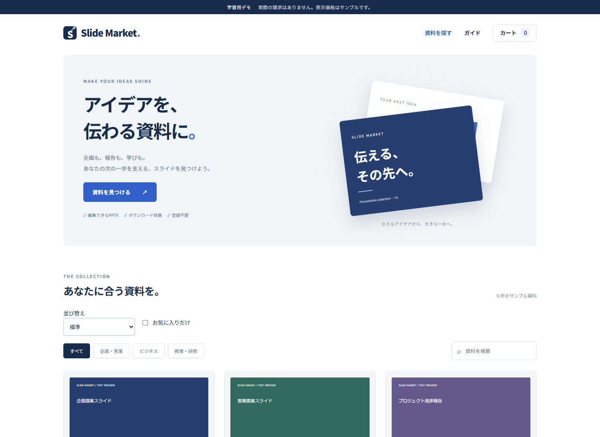
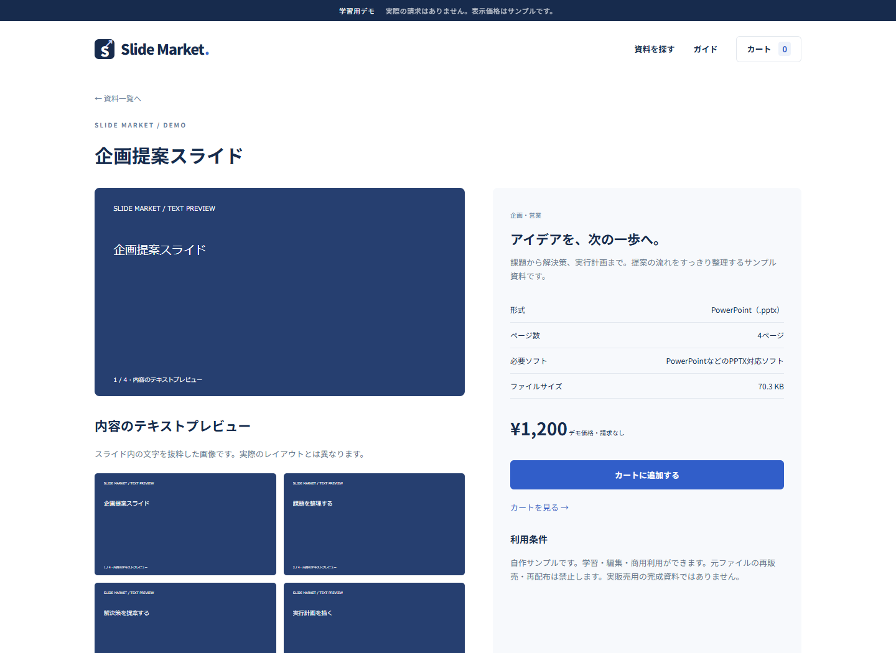
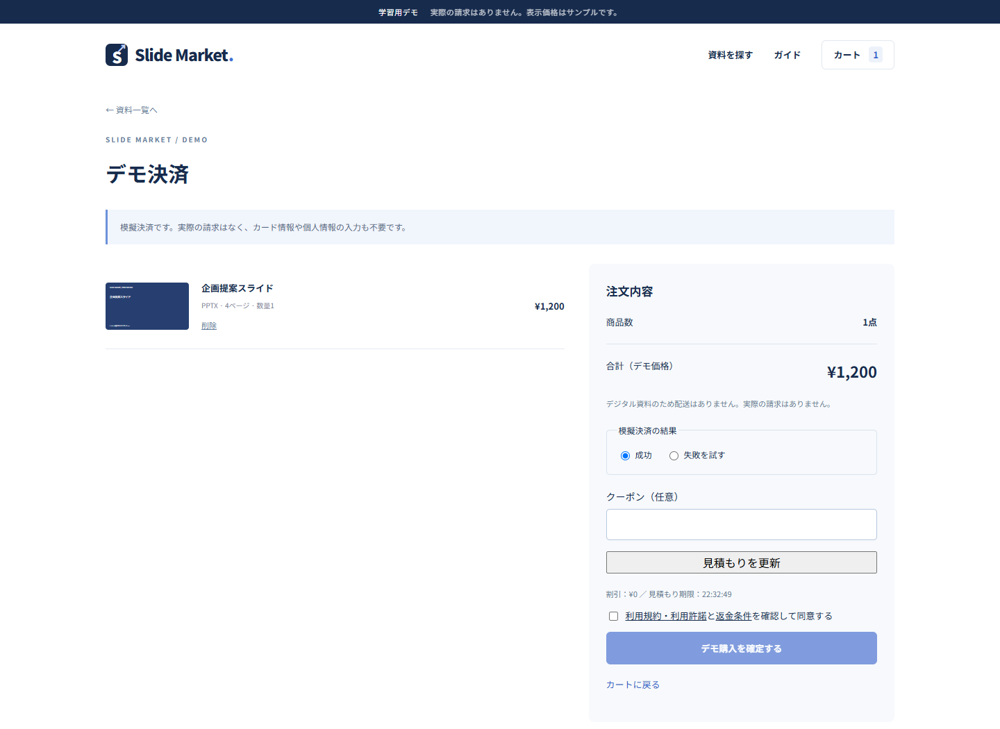
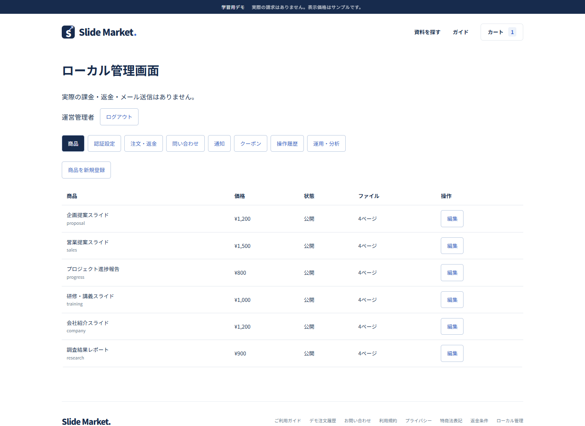
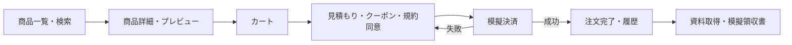
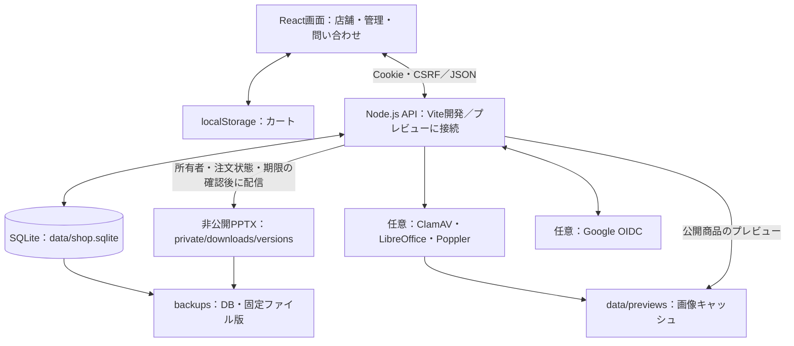
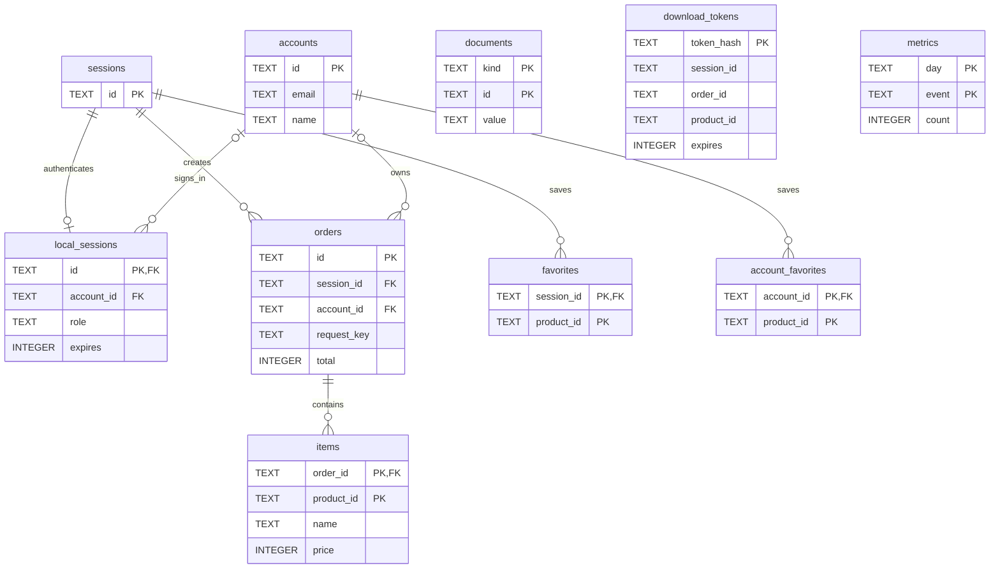

# Slide Market

PowerPoint資料の検索から模擬購入、ダウンロード、店舗運営までを体験する学習用ECデモです。実際の請求・返金・メール配信は行いません。

## 2. 利用者の困りごとと、このツールでの解決方法

| 想定される困りごと | このツールでできること |
| --- | --- |
| 資料販売の購入フローを、決済サービスへ登録する前に試したい | 商品検索、カート、見積もり、規約同意、成功・失敗を選べる模擬決済、注文履歴をローカルで確認できます。 |
| 資料の内容を確認してから選びたい | 商品説明、ページ数、対応ソフト、画像または文字抜粋のプレビューを確認できます。 |
| 購入した資料を再取得したい | 注文履歴から購入時のファイル版を取得できます。任意のGoogleログインを設定すると、同一アカウントの別端末でも履歴を参照できます。 |
| 購入していない人へのファイル配信を防ぐ仕組みを学びたい | APIで注文の所有者・状態・期限を照合し、発行元セッション専用の短期リンクで配信する動作を確認できます。 |
| 商品・問い合わせ・返金・バックアップをまとめて試したい | 管理画面と運用コマンドで、商品公開、PPTX登録、問い合わせ対応、全額模擬返金、バックアップ・復元を操作できます。 |

## 3. アプリケーション概要

デジタル資料の販売を検討している人、ECの購入・運営フローや権限管理を学ぶ開発者向けです。Node.js・SQLite・ローカルファイルで動作し、基本機能の利用に外部サービスのアカウントは不要です。

購入者側の画面と運営側の管理画面を備えています。Google認証と無料の変換・検査ツールは任意の追加設定です。現在のローカル実装と、将来の実販売向け設計は区別しています。

## 4. 主な機能

| 機能 | 利用者ができること・現在の動作 |
| --- | --- |
| 商品を探す | 検索、価格・新着順の並び替え、お気に入り、セット商品の選択。 |
| 商品を確認する | 説明・サイズ・ページ数・対応ソフトを確認。画像プレビューは最大12ページ、変換できない場合は文字抜粋。 |
| 模擬購入する | 10分有効のサーバー計算見積もり、クーポン、規約・返金条件への同意。価格変更・購入済み資料・セット内の重複を確認。 |
| 購入履歴から取得する | 購入時のファイル版を取得。リンクは5分有効で、発行したブラウザセッション専用。返金後は使用不可。 |
| アカウントで共有する | 任意のGoogle OIDCログイン。同じブラウザの匿名注文・お気に入りを引き継ぎ、別セッションで履歴を共有。実Google認証は未検証。 |
| 模擬領収書を確認する | 購入時の商品・割引・合計と、仮の税込10%モデルの税額をHTML表示・保存・印刷。実入金の証明や適格請求書には使用不可。 |
| 商品を管理する | 商品の新規登録・編集・下書き・公開・販売停止、セット販売、更新競合の検出、50MB以下のPPTX登録。 |
| ファイルを検査する | PPTX構造検査、任意のClamAV検査、LibreOffice＋Popplerによる画像生成。検査必須モードでは未検査ファイルの公開・新規購入を拒否。 |
| 注文・問い合わせへ対応する | 注文検索、理由付き全額模擬返金、問い合わせの保存・対応状態更新。返金時は購入権限と発行済みリンクを停止。 |
| 通知を確認する | 購入・返金・問い合わせの通知をローカル保存。5秒周期で処理し、失敗時は最大8回再試行。外部メールは送信しない。 |
| 管理者を保護する | 運営管理者・商品管理者の権限分離、CSRF、回数制限、任意のTOTP MFA・復旧コード、返金前の5分有効の再認証、操作履歴。 |
| 運用状況を確認する | DB・通知の状態、日別イベント件数、手動／自動バックアップ、整合性検査、復元演習。自動バックアップは既定で24時間ごと・直近7件保持。 |
| 商品ページを生成する | 商品別URL、ビルド時のメタ情報・構造化データ・サイトマップ生成。 |

## 5. 画面・利用イメージ

2026年10月19日に、専用の一時データを使って実際のアプリ画面を撮影しました。PCは1440×1050、スマートフォンは390×844の表示です。

### 店舗トップ（PC）

資料の検索・カテゴリ選択・並び替え・お気に入りを利用できます。



### 商品詳細

商品説明、価格、対応ソフト、ページ数を確認し、カートへ追加できます。撮影環境には画像変換ツールがないため、文字抜粋プレビューを表示しています。



### 購入確認・模擬決済

見積もり、クーポン、規約への同意、模擬決済の成功・失敗を確認する画面です。実際の請求やカード情報の入力はありません。



### 管理画面

運営管理者としてログインした商品一覧です。商品の登録・編集に加え、注文・問い合わせ・通知・認証・運用機能へ移動できます。



### 店舗トップ（スマートフォン）

同じ店舗画面がスマートフォンの幅に合わせて表示されます。


### 代表的な操作の流れ



| 画面 | URL・表示先 | 主な操作 |
| --- | --- | --- |
| 店舗 | `http://localhost:5173/` | 一覧・検索・お気に入り |
| 商品詳細 | `/products/商品ID` | 説明・プレビュー・カート追加 |
| 購入確認 | `/#cart` → `/#checkout` | 見積もりと規約同意、模擬決済 |
| 注文履歴 | `/#history` | 購入済み資料の再取得、模擬領収書 |
| 問い合わせ | `/#contact` | 問い合わせ登録 |
| 販売条件 | `/#legal/種類` | 規約・許諾・返金条件など |
| 管理画面 | `http://localhost:5173/#admin` | 商品・注文・問い合わせ・通知・認証・運用 |

管理画面には運営管理者と商品管理者のログインがあります。運営管理者は全機能、商品管理者は商品編集・ファイル登録と自身の認証設定を操作できます。

## 6. 技術スタック

| 分類 | 使用技術 | 用途 |
| --- | --- | --- |
| UI | React 19、TypeScript、CSS | 店舗・管理画面、APIの型定義 |
| 開発・ビルド | Vite 7、TypeScript | 開発サーバー、型検査、フロントエンド生成 |
| API | Node.js 24、JavaScript ES Modules | Viteの開発／プレビューへ接続するローカルAPI |
| DB | Node.js組み込みの `node:sqlite`、SQLite | 商品・注文・認証・問い合わせ・運用情報 |
| PPTX | JSZip、PptxGenJS | PPTXの構造検査、初期サンプル生成 |
| 任意の認証 | openid-client 6、Google OIDC | 購入者ログイン、state・nonce・PKCEの検証 |
| 任意のローカルツール | LibreOffice Impress、Poppler（pdftoppm）、ClamAV | 画像生成・ウイルス検査 |
| テスト | Node.js Test Runner、Playwright | サーバー・ファイル処理・PC／モバイルの検証 |
| コミット検査 | GitSecurityTool、pre-commit、gitleaks | 秘密情報・独自キーワード・基本形式の検査 |

依存バージョンの定義は [package.json](package.json)、固定された依存関係は [package-lock.json](package-lock.json) を参照してください。

## 7. システム構成



1. 画面がAPIから公開商品を取得します。カートはブラウザ内に保存します。
2. 購入確認でAPIが価格・クーポン・公開状態を確認し、10分有効の見積もりを保存します。
3. 同意後の模擬購入で再検証し、注文・購入時の商品／ファイル版／販売条件・通知を同じDBトランザクションで記録します。
4. ダウンロード要求時と実際の取得時に所有者・注文状態を確認します。トークンはDBへハッシュで保存し、5分の期限と発行元セッションも照合します。
5. 通知はAPIプロセス内の周期処理でローカル保存状態へ更新します。外部配信サービスへの接続はありません。

Google設定がない場合は匿名のブラウザセッションで利用できます。Google設定時は認証後のアカウントに注文・お気に入りを関連付けます。

## 8. 構成のポイントと採用理由

以下は既存の説明資料と実装から確認できる方針・動作です。React・Vite・JSON文書方式を他の技術より優先した比較選定の経緯は、コード上では確認できません。

| 構成のポイント | 確認できる目的・利点 | トレードオフ・制約 |
| --- | --- | --- |
| Node.js・SQLite・ローカルファイルで完結 | 外部サービス登録前に購入・運営を試す学習用構成。DBサーバーの別途構築が不要。 | 現在は同一DBを利用するサーバーの多重起動を拒否。本番DB・複数台構成は未対応。 |
| React画面とサーバーAPIを分離 | 画面から送られる価格を採用せず、APIが価格・所有者・権限を確認する。 | フロントエンドの静的ファイルだけでは購入・配信機能が動かない。 |
| 購入時の版と条件を保存 | 商品更新後も購入時の資料・価格・規約を参照できる。PPTXはSHA-256単位で固定。 | DBと固定ファイル版の両方を保管・復元する必要がある。 |
| Googleログインを任意にする | 未設定でも匿名購入を試せる。設定すると同一アカウントで端末間共有できる。 | 匿名注文は同じブラウザのCookieが必要。本人のメール確認は匿名セッションでは行わない。 |
| プレビューと検査の状態を区別 | 画像変換ができなくても文字抜粋で商品を確認できる。検査必須モードでは未検査商品の販売を止める。 | 画像の代替表示はウイルス検査の代わりにはならない。変換結果はPowerPointと異なる場合がある。 |
| ローカル通知・バックアップ | 外部サービスなしで再試行や復元を確認できる。 | 外部メール・監視は未実装。同じディスクのバックアップだけではディスク故障へ対応できない。 |
| 関係テーブルとJSON文書を併用 | 注文・明細はSQLで関連付け、商品や購入時の補足情報は `documents` に保存する実装。 | JSON内の参照にはDBの外部キーがない。採用理由の比較記録は確認できない。 |

## 9. DB構造

現行スキーマは [storage.mjs](02.src/server/storage.mjs) の `openStore()` が定義します。通常の保存先は `data/shop.sqlite`。WALと外部キー検査を有効にしています。DBは初回起動時に作成され、現行コードでは不足する `account_id` 列の追加も行います。

| テーブル | 用途・主要な列 | キー・制約 |
| --- | --- | --- |
| `accounts` | Googleアカウントの識別ID、メール、表示名、作成／更新日時 | `id` が主キー。`email` のUNIQUE制約はない。 |
| `sessions` | ブラウザセッションの識別ID | `id` が主キー。 |
| `local_sessions` | セッションの役割、期限、CSRF、任意のアカウントID | `id` は主キーかつ `sessions.id` への外部キー。`account_id` は `accounts.id` への任意の外部キー。 |
| `orders` | 注文ID、セッション、日時、合計、操作キー・要求内容、任意のアカウントID | `id` が主キー。`session_id` → `sessions.id`、`account_id` → `accounts.id`。`(session_id, request_key)` がUNIQUE。 |
| `items` | 購入時の商品ID・商品名・単価 | `(order_id, product_id)` が複合主キー。`order_id` → `orders.id`、注文削除時にCASCADE。 |
| `documents` | 商品、ファイル版、見積もり、注文補足、管理認証、通知などのJSON | `(kind, id)` が複合主キー。`value` はJSON文字列を保存するTEXT列。 |
| `favorites` | 匿名ブラウザのお気に入り | `(session_id, product_id)` が複合主キー。`session_id` → `sessions.id`。 |
| `account_favorites` | ログイン済みアカウントのお気に入り | `(account_id, product_id)` が複合主キー。`account_id` → `accounts.id`、アカウント削除時にCASCADE。 |
| `download_tokens` | トークンハッシュ、セッション・注文・商品ID、期限 | `token_hash` が主キー。関連IDにDBの外部キー制約はない。APIで所有権・注文状態を確認する。 |
| `metrics` | 日別・イベント別の件数 | `(day, event)` が複合主キー。 |

`orders(account_id, date DESC, id DESC)` に索引があります。主なDB上の関係は次のとおりです。



`product_id` は `documents(kind='products')` の商品を指す論理参照で、商品テーブルへの外部キーではありません。`documents` の主な `kind` は、`products`、`versions`、`quotes`、`orderMeta`、`credentials`、`coupons`、`inquiries`、`notifications`、`audit`、`errors`、`maintenance` です。

注文状態（`paid`・`refunded`）、購入時の明細版・規約・模擬領収書などは `orderMeta` のJSONに保存します。通知状態は `pending`・`saved`・`failed`。商品状態などもJSON内で管理し、SQLのENUMやCHECK制約ではありません。将来設計書にある本番向けDB構成と、現在のSQLiteスキーマは異なります。

## 10. セットアップ方法

### 前提条件

- Node.js 24とnpm、Git。
- GitSecurityToolの取得と初回依存関係インストールには通信が必要です。
- Python 3.11以上はコミット検査用です。アプリの基本動作には不要です。
- LibreOffice・Poppler・ClamAVとGoogle設定は、該当機能を使用する場合のみ用意します。

### 依存関係と起動

取得済みのプロジェクトのルートで実行します。

```sh
git submodule update --init --recursive
npm ci
npm run dev
```

新規clone時にサブモジュールも取得する場合は `git clone --recurse-submodules <repository-url>` を使用します。

店舗は `http://localhost:5173/`、管理画面は `http://localhost:5173/#admin` です。ポートを変更した場合はURLも変更してください。

初回起動時にSQLite、初期商品、購入時の固定ファイル版を用意します。DBの手動作成は不要です。初期サンプルのPPTXは `private/downloads/` に含まれています。再生成する場合は `npm run generate` を実行します。初回取り込み後の商品変更は管理画面から行います。

管理用パスワードを環境変数で指定しない場合は、次のローカルファイルを生成します。実際の値は共有しないでください。

- `data/admin-password.txt`：運営管理者。
- `data/editor-password.txt`：商品管理者。

管理ログインは1時間、購入者セッションは30日で失効します。パスワード紛失時はサーバー停止後に `npm run admin:reset` を実行します。管理者のMFAと既存管理セッションの権限も解除されます。

### コミット検査

Python環境がある場合は次を実行します。

```sh
python -m pip install pre-commit
python -m pre_commit install
python -m pre_commit run --all-files
```

この作業環境では `.tools/python/` にPython 3.13.7とpre-commitを導入し、フックを有効化済みです。PowerShellでの手動実行例です。

```powershell
$env:PRE_COMMIT_HOME = Join-Path $PWD '.tools/pre-commit'
& ./.tools/python/python.exe -m pre_commit run --all-files
```

`.tools/` はGit管理外のため、別のclone環境には付属しません。検査ラッパーはローカルPythonがあれば優先し、なければ `python` コマンドを使用します。独自の検知語は `GitSecurityTool/GitSecurityTool/keywords.yaml` にローカルで設定します。新しい環境ではサブモジュールの `.git/info/exclude` に同ファイルと検知ログを除外登録し、独自情報をコミットしないでください。

## 11. 環境変数

基本のローカル利用では、アプリの環境変数はすべて省略できます。バックエンドは `process.env` を参照するため、起動するシェルや実行環境に設定してください。現在のサーバー設定には、`.env` の値をバックエンドの `process.env` へ明示的に読み込む処理はありません。

| 変数名 | 用途・既定値 | 必須か |
| --- | --- | --- |
| `SHOP_DATA_DIR` | DB・管理パスワード・画像キャッシュなどの保存先。既定 `data`。 | 任意 |
| `SHOP_FILE_DIR` | 初期PPTXと `versions/` の保存先。既定 `private/downloads`。変更先には初期PPTXも必要。 | 任意 |
| `SHOP_BACKUP_DIR` | バックアップ保存先。既定 `backups`。 | 任意 |
| `LOCAL_ADMIN_PASSWORD` | 運営管理者の初期パスワード。未設定ならランダム生成。既存資格情報は上書きしない。 | 任意 |
| `LOCAL_EDITOR_PASSWORD` | 商品管理者の初期パスワード。同上。 | 任意 |
| `GOOGLE_CLIENT_ID` | GoogleのOAuthクライアントID。 | Googleログイン時に必須 |
| `GOOGLE_CLIENT_SECRET` | GoogleのOAuthクライアントシークレット。 | Googleログイン時に必須 |
| `GOOGLE_REDIRECT_URI` | コールバックURL。ローカル例 `http://localhost:5173/api/auth/google/callback`。 | Googleログイン時に必須 |
| `SHOP_COOKIE_SECURE` | `true` のときCookieへSecure属性を付与。既定は無効。HTTPS環境では有効にする。 | 任意 |
| `SHOP_SCAN_MODE` | `auto`（既定）／`required`／`off`。`required` では未検査商品の公開・新規購入も拒否。 | 任意 |
| `CLAMSCAN_PATH` | ClamAV実行ファイル。既定 `clamscan`。 | 任意 |
| `CLAMAV_DATABASE_DIR` | ClamAV定義の場所。未指定時は存在する `SHOP_DATA_DIR/clamav`、なければツール既定の場所。 | 任意 |
| `LIBREOFFICE_PATH` | LibreOffice実行ファイル。既定 `libreoffice`。 | 任意 |
| `PDFTOPPM_PATH` | Poppler実行ファイル。既定 `pdftoppm`。 | 任意 |
| `SHOP_BACKUP_INTERVAL_MS` | 自動バックアップ間隔。既定 `86400000`（24時間）、`0` で無効。 | 任意 |
| `SHOP_BACKUP_KEEP` | 自動バックアップの保持数。既定 `7`、範囲 `1`〜`365`。手動分は保持数削除の対象外。 | 任意 |
| `SITE_URL` | ビルド時の商品URL・サイトマップの公開オリジン。未設定ならローカルURLを使用しrobots.txtで登録を禁止。 | 任意 |
| `CHROMIUM_PATH` | Playwrightが起動するブラウザ実行ファイルのパス。 | 任意・テスト用 |
| `CI` | 設定時、Playwrightが既存開発サーバーを再利用しない。 | 任意・テスト用 |
| `PRE_COMMIT_HOME` | pre-commitのキャッシュ先。この環境の例は `.tools/pre-commit`。 | 任意・開発用 |

Googleログインは3変数すべてが設定された場合に有効です。Google Cloud側にも同じリダイレクトURIを登録し、必要に応じてテストユーザーを設定します。実際の資格情報はREADMEやGitへ記載せず、シェル・実行環境のSecret設定などで管理してください。詳細は [運用手順](01.doc/local-operations.html) を参照してください。

## 12. 利用可能なコマンド

すべてプロジェクトルートで実行します。

| コマンド | 内容・条件 |
| --- | --- |
| `npm ci` | ロックファイルに沿った依存関係のインストール。 |
| `npm run dev` | 開発用の画面とAPIを起動。 |
| `npm run build` | TypeScript型検査、Viteビルド、商品別SEOファイル生成。 |
| `npm run preview` | `dist/` とローカルAPIを起動。通常のURLは `http://localhost:4173/`。 |
| `npm run generate` | 初期商品JSONからサンプルPPTXと表紙SVGを再生成。 |
| `npm test` | PlaywrightのPC／モバイルテスト。ブラウザ実行環境が必要。 |
| `npm run test:server` | Node.jsによるサーバー・ファイル処理テスト。 |
| `npm run test:tools` | 実際の無料ツールによる変換・検査テスト。該当ツールが必要。 |
| `npm run tools:check` | LibreOffice・Poppler・ClamAVの利用可否を確認。 |
| `npm run assets:prepare` | 既存ファイル版の検査・画像準備。サーバー停止後に実行。 |
| `npm run backup` | DBと固定ファイル版の手動バックアップ。 |
| `npm run backup:list` | バックアップ一覧。 |
| `npm run backup:check -- バックアップ名` | チェックサム・SQLite・外部キー・購入済みファイルを検証。 |
| `npm run restore:drill -- バックアップ名` | 一時領域で復元演習。通常のDBは変更しない。 |
| `npm run restore -- バックアップ名` | 検査後に復元。開発／プレビューサーバーを停止して実行。 |
| `npm run admin:reset` | 管理パスワード再発行、MFA・既存管理セッション権限の解除。サーバー停止後に実行。 |
| `npm run admin:otp` | ローカル確認用の運営管理者TOTP生成。商品管理者は `npm run admin:otp -- editor`。 |

同じDBの端末でTOTPを生成する方法は、独立した第二要素にはなりません。バックアップ・復元の具体的な手順は [ローカル運用手順](01.doc/local-operations.html) を参照してください。

## 13. ドキュメント・設計書

[設計・運用ドキュメント一覧](01.doc/index.html) をブラウザで開くと、各資料を閲覧・印刷・PDF保存できます。

| 資料 | 内容 |
| --- | --- |
| [要件・初期設計](01.doc/demo-requirements.html) | 要件、完成条件、設計履歴。 |
| [ローカル基本設計](01.doc/local-basic-design.html) | 現行の画面・API・SQLite・権限・運用仕様。DBとテスト方針も収録。 |
| [実運用に向けた基本設計](01.doc/production-basic-design.html) | 本番に向けた構成案・決済・データ・運用設計。現行実装と将来案を区別。 |
| [ローカル運用手順](01.doc/local-operations.html) | ツール準備、ファイル処理、バックアップ・復元。 |
| [残課題の調査結果](01.doc/issue-investigation.html) | ビルドの原因と比較試験、ブラウザテスト、資料再生成の不具合、外部設定待ち。 |
| [実装状況と残作業](01.doc/implementation-status.html) | 実装範囲、最新の検証記録、未設定・未実装事項。 |
| [ECサイトの設計パターン](01.doc/ec-site-patterns.html) | 販売モデル、画面、構成方式の比較資料。 |
| [初期静的デモの履歴](01.doc/static-demo-history.html) | 過去の構成と仕様。現行仕様とは異なる。 |
| [作業状況](03.log/current_status.txt)・[残課題](03.log/leftover_tasks.txt) | 作業履歴、未解決事項。 |

独立したDB設計書・詳細設計書・テスト仕様書は現在ありません。DBスキーマは `storage.mjs`、テストケースは `02.src/tests/` と基本設計内の記述を参照してください。

## 14. デプロイ方法

現在確認できる提供形態は、開発サーバーまたはローカルのビルド／プレビューです。本番向けデプロイ設定や独立した本番APIサーバーは用意していません。

```sh
npm run build
npm run preview
```

ビルドが成功すると `dist/` に画面・商品別HTML・サイトマップを生成します。プレビューでもViteのプラグインからAPIを起動するため、実行時にはNode.js、サーバー実装、依存関係、DB、非公開PPTXが必要です。`dist/` だけを静的ホスティングへ置いてもAPIは動きません。

システムのNode.js 24.11.1ではビルドが異常終了しますが、比較用24.13.1へPATHを切り替えた環境では上記ビルドが2回成功しました。実販売には決済・Webhook・外部メール・本番ストレージ・HTTPS・運用基盤などの追加実装と検証が必要です。

## 15. 制約・注意事項

- **学習用の模擬販売です。** 実決済、実返金、Webhook入金確認、外部メール配信、本番ストレージ、外部障害通知は未実装です。模擬注文や模擬領収書は入金の証明になりません。
- **最新の確認結果（2026年10月19日）：** Windows対応後のサーバー・ファイル処理テスト11件と、移動後の対象ファイルを含むセキュリティフック検査は成功しました。構成整理時はビルド成功、その後の再実行は型検査・32モジュール変換後にWindows異常終了 `0xC0000409` で停止しています。調査でNode.js 24.11.1の日本語パスに対する `fs.rmSync()` の不具合と特定しました。比較用の24.13.1では通常ビルドが2回連続で成功しています。システムのNode.jsは未更新のため、修正を含む24系への更新が必要です。
- その後、比較用Node.js 24.13.1とEdgeでアプリのブラウザテストを実行し、14件中12件成功・2件失敗でした。失敗は非公開URLの403期待に対してSPAのHTMLが200で返る箇所で、実ファイルのアクセスは403でした。実Google認証は環境変数未設定、実変換・検査ツールは現在の設定で利用不可のため未検証です。HTML資料の全8ページはリンク・PC／スマートフォン表示を確認済みです。過去のLinux環境でのブラウザ依存ライブラリ不足の記録と、現在のWindowsビルド異常は別の問題です。
- 匿名注文の取得には元のブラウザCookieが必要です。Googleログイン済みなら別端末でもログインしてリンクを再発行できます。返金後も、取得済みファイルの回収はできません。
- `data/`、`backups/`、`00.secret/`、生成済みファイル版、環境変数ファイルはGit管理外です。DB・バックアップには個人情報とMFA関連情報が含まれます。公開・共有しないでください。
- DB変更前はバックアップし、DBと `private/downloads/versions/` を整合させて復元します。一般的なスキーマ移行ツールは未導入です。JSON内の関係はDBの外部キーでは保護されません。
- 自動バックアップはサーバー稼働中のみ実行します。同じディスクの保存はディスク故障対策にならず、別媒体への保管は運営者が行います。
- ClamAVの定義更新と変換プロセスのOS隔離は別途必要です。`SHOP_SCAN_MODE=auto` ではClamAV未導入を未検査として扱います。検査失敗や問題検出時は登録を拒否します。
- 商品メタ情報はビルド時点の情報です。変更後は再ビルドが必要です。`SITE_URL` 未設定では検索エンジンの登録をrobots.txtで禁止します。イベント件数は厳密な利用人数・転換率を示しません。
- 販売者情報、実販売の税・領収書、返金条件、個人情報の保存期間は販売開始前に確定する必要があります。

## 16. ディレクトリ構成

```text
ec_site_sample/
├── 00.secret/                 # ローカル秘密情報（Git管理外）
├── 01.doc/                    # HTMLの要件・設計・運用資料、作成ルール
│   ├── index.html             # 資料一覧
│   └── assets/                # 共通の資料用CSS
├── 02.src/
│   ├── src/                   # React画面・API型・初期商品JSON・CSS
│   ├── server/                # API・SQLite・認証・ファイル・運用処理
│   ├── scripts/               # サンプル生成・SEO・バックアップ・検査
│   ├── tests/                 # Node.js・Playwrightテスト
│   ├── public/previews/       # 初期商品の表紙SVG
│   └── index.html             # アプリのHTML入口
├── 03.log/                    # 再利用プロンプト・進捗・残課題
├── GitSecurityTool/           # コミット検査用サブモジュール
├── private/downloads/         # 初期サンプルPPTX
│   └── versions/              # SHA-256で固定する版（生成・Git管理外）
├── data/                      # SQLite・管理パスワード等（生成・Git管理外）
├── backups/                   # DB・固定ファイル版（生成・Git管理外）
├── dist/                      # ビルド成果物（生成・Git管理外）
├── .tools/                    # この環境のローカル開発ツール（Git管理外）
├── .pre-commit-config.yaml    # コミット検査設定
├── vite.config.mjs            # 画面とAPIの開発／プレビュー設定
├── playwright.config.ts      # PC／モバイルテスト設定
├── tsconfig.json              # TypeScript設定
├── package.json
├── package-lock.json
└── README.md
```

設定ファイルとnpmコマンドの実行場所はプロジェクトルートです。既存データを保つため、DB・バックアップ・配布ファイルの保存先は番号付きフォルダへ移動せず維持しています。

## 17. ライセンス

アプリケーション全体のライセンスは未定義です。プロジェクトルートにLICENSEファイルは確認できません。`package.json` の `private: true` はnpm公開を防ぐ設定で、利用許諾を定めるものではありません。

既存の説明では、初期サンプルPPTXは自作資料で、学習・編集・商用利用を許可し、元ファイルの再販売・再配布は禁止しています。この条件をアプリ全体のライセンスとは扱いません。依存ライブラリ・サブモジュールには、それぞれの利用条件が適用されます。
